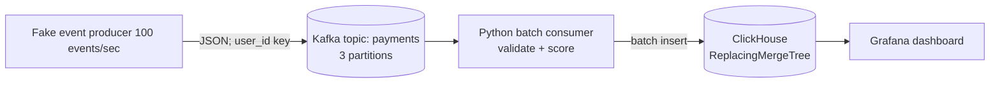

# Real-time Payment Analytics & Fraud Detection

A project that streams payment events through Kafka, scores them with rules, stores them in ClickHouse, and displays the results in Grafana. 

## Architecture


Raw data columns in Event Producer:
`transaction_id`, `timestamp`, `user_id`, `merchant`, `amount`, `payment_method`, `status`, `country`, `device_id`

Fraud scoring columns:
`is_suspicious`, `fraud_reason`, `risk_score`

1) The producer creates fake events and occasional scenarios that have large-payments, rapid-transaction, repeated-decline, and country-change rules. 
2) Kafka records are keyed by `user_id`, so events for one user land on the same partition. 
3) The consumer uses manual commits and sends batches to ClickHouse.

## Fraud rules

Rules are configurable through `.env`:

| Rule | Default behavior | Base risk weight |
|---|---|---:|
| `large_payment` | Amount >= 2,500 | 45 |
| `rapid_transactions` | 4 transactions for a user within 60 seconds | 30 |
| `repeated_declines` | 4 declined transactions for a user within 10 minutes | 35 |
| `geo_mismatch` | Country changes for a user within 15 minutes | 40 |

Weights are summed and capped at 100. Any triggered rule marks the event suspicious. 


## Quick start


```bash
docker compose up --build -d
docker compose ps
docker compose logs -f producer consumer
```

The local stack exposes:

- Grafana: <http://localhost:3000> (credentials from `.env`, defaults `admin` / `change-me-local`)
- ClickHouse HTTP: <http://localhost:8123>
- Kafka bootstrap endpoint: `localhost:9092` for host-side clients; containers use `kafka:9092`

`docker compose down -v` also deletes the Kafka, ClickHouse, and Grafana demo volumes.


## Example Event

Example producer message (timestamps are UTC):

```json
{
  "transaction_id": "f5e81c90-4f41-44ad-a264-d3b6e2fd9e32",
  "timestamp": "2026-10-09T07:15:00.123+00:00",
  "user_id": "user_0042",
  "merchant": "northwind_shop",
  "amount": 84.75,
  "payment_method": "card",
  "status": "approved",
  "country": "US",
  "device_id": "device_user_0042"
}
```

